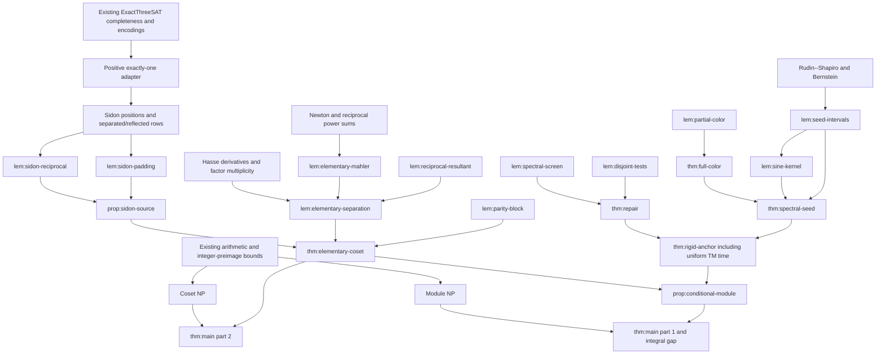

# Power2ModuleSVP: phase-one formalisation plan

Research date: 2026-10-25. This is an implementation specification, not a
claim that the target theorems have been formalised. Mathematical descriptions
below are independently written; references such as `lem:parity-block` are
private-manuscript labels. Do not add the manuscript, excerpts, or PDFs to this
repository.

The recommended first milestone is **unconditional coset NP-completeness and
module NP-completeness conditional only on a uniform polynomial-time rigid
anchor family**. Establishing that family in Lean is a separate substantial
project. If separation is also left conditional, both theorem statements must
say so explicitly.

## 1. Mathematical targets and representation

### The two parts of `thm:main`

For every positive dyadic degree `d = 2^k` (including `k = 0`), let
`R_d = ℤ[X]/(X^d + 1)`. Use the unique representative of degree below `d`.
For a ring element take the maximum absolute coefficient; for a pair take the
maximum over both coordinates. The input degree and all coefficient arrays
are explicit, and coefficients are signed binary integers.

1. **Module language.** A valid input is a nonsingular two-by-two matrix over
   `R_d`. It is accepted exactly when its column span over `R_d` contains a
   nonzero vector whose coefficient maximum norm is at most one. This language
   is NP-complete under deterministic polynomial-time many-one reductions.
   Hardness already holds for columns `(g,0)` and `(h,J)`, with coefficients
   of `g` in `{0,2}`, of `h` in `{-1,0,1,3}`, and of `J` in `{-1,1}`.
   The reduction gives first minimum exactly one on YES inputs and at least
   two on NO inputs.
2. **Principal-coset language.** A valid input is `d,g,h`, with `g` nonzero
   and coefficientwise even, and arbitrary `h`. Acceptance means that
   `h + gR_d` contains a vector in `{-1,0,1}^d`. This language is NP-complete
   with the same deterministic reductions, even with the above restrictions
   on `g,h`. A zero coset point is permitted.

Both languages reject malformed inputs. The coefficient promises describe
the **hardness outputs**, not extra restrictions on the general languages.
The norm is neither the canonical embedding norm nor the squared Euclidean
norm used in the earlier rank-two library. The integral gap also yields the
paper's search consequence for each fixed approximation factor below two;
that search formalisation is a follow-on result, not needed for the decision
NP-completeness statements.

### Reuse the existing power-of-two ring

Choose the genuine quotient already implemented in `IdealCVP`, together with
its existing coefficient model:

```lean
abbrev Coeff := IdealCVP.Coeff
-- Coeff d = Fin d → ℤ
abbrev Rd := IdealCVP.Cyclotomic.QuotRing
-- Rd d = AdjoinRoot (IdealCVP.Cyclotomic.modulus d)
-- modulus d = (Polynomial.X : Polynomial ℤ)^d + 1
```

`IdealCVP/Quotient.lean` supplies
`quotEquiv (hd : 0 < d) : Coeff d ≃ₗ[ℤ] Rd d`, `toQuot`, and
`toQuot_mul hd`. `IdealCVP/GeneralFullRank.lean` proves cyclotomic
irreducibility, `quotRing_isDomain (hd : ∃ k, d = 2^k)`, and injectivity of
negacyclic multiplication by a nonzero element.

Use coefficient functions for bounds, parity, block decompositions, and finite
combinatorics. Use `AdjoinRoot` for ring identities, ideal membership, factors,
and module bases. Use lists for executable programs and encoding. Bridge with
`IdealCVP.ofList`, `toList`, `ofList_negacyclicMul`, and `quotEquiv`; do not
construct a second ring instance on coefficient functions. This avoids a new
associativity/domain development and a new quotient normal-form development.

The auxiliary quotient `ℤ[X]/(X^L+P)` has a different modulus and must not be
identified with `Rd L`. Work with `Polynomial.modByMonic` over `ℤ`, and use
`AdjoinRoot (X^L+P)` only when a quotient is actually useful. This quotient
need not be a domain or reduced.

### Concrete input and bit languages

Use threshold-free tuples; the threshold is permanently one. These are
exactly existing arithmetic argument types, so no new encoding machinery is
needed:

```lean
abbrev CosetInput := IdealCVP.RingArgs
-- ℕ × (List ℤ × List ℤ), interpreted as (d,(g,h))
abbrev SVPInput := IdealCVP.PairRingArgs
-- ℕ × ((List ℤ × List ℤ) × (List ℤ × List ℤ))
-- interpreted as (d,((G₁₁,G₂₁),(G₁₂,G₂₂))) -- COLUMNS
def encCoset : CosetInput ↪ List Bool := IdealCVP.encRingArgs
def encSVP : SVPInput ↪ List Bool := IdealCVP.encPairRingArgs
```

Both encodings use `encUnary` for `d`, `encIntBin` for integers, and the
existing self-delimiting `encList`/`encPair` framing. Unary degree is deliberate:
the existing arithmetic and anchor construction are polynomial in the explicit
degree. A binary-degree variant is a later polynomial-equivalence exercise
with length checks before allocation, not an implicit change to this API.
Indeed, valid arrays already contain at least `d` encoded entries. Convert
binary degree to unary only after comparing it with the actual list lengths;
map an invalid shape to a fixed NO instance. The reverse conversion is
immediate. Thus this choice can be related to the paper's explicit-array
convention without an exponential conversion on malformed inputs.

Coset well-formedness requires `d = 2^k`, both lengths exactly `d`, nonzero
`ofList g`, and every coefficient of `g` even. Module well-formedness requires
`d = 2^k`, all four lengths exactly `d`, and
`IdealCVP.listIndependent d col₁ col₂ = true`. The latter is already a
polynomial-time ring-determinant check. By the existing domain theorem it
means `det G ≠ 0`, injectivity of the span map, and a free full-rank module.
Dimension zero is rejected. Dimension one is valid.

Do not silently truncate or zero-pad malformed input arrays: `ofList` is total,
but language membership also requires the exact lengths. Bit languages are
the images `encCoset '' CosetLang` and `encSVP '' ModuleSVPLang`; strings
outside the respective encoding image are NO. State the usual injective
encoding membership equivalence as in `Rank2ModuleSVP/Problem.lean`.

The final decision targets, in namespace `Power2ModuleSVP`, are:

```lean
theorem coset_mem_NP : CosetLang ∈ Cslib.Complexity.NP encCoset
theorem moduleSVP_mem_NP : ModuleSVPLang ∈ Cslib.Complexity.NP encSVP
theorem coset_npComplete : Cslib.Complexity.NPComplete encCoset CosetLang
theorem moduleSVP_npComplete_of (hJ : RigidAnchorFamilyHypothesis) :
  Cslib.Complexity.NPComplete encSVP ModuleSVPLang
-- After constructing the family:
theorem moduleSVP_npComplete :
  Cslib.Complexity.NPComplete encSVP ModuleSVPLang
```

The last theorem requires an actual proof of `RigidAnchorFamilyHypothesis`.
No `WanPowerSumEstimates` premise is needed for this project.

## 2. Existing infrastructure and local library search

All searches below were against the installed sources; no dependency update
or cache download was performed. Mathlib paths are relative to
`/workspace/polysvp/.lake/packages/mathlib/Mathlib`. Complexitylib paths are
relative to `.lake/packages/complexitylib/Complexity` in this working copy.

| Existing source | Reuse and limits |
| --- | --- |
| `IdealCVP/Quotient.lean`, `GeneralFullRank.lean` | The exact power-of-two quotient, coefficient equivalence, irreducibility and domain facts. Prefer these to a new Eisenstein proof. |
| `IdealCVP/ModuleSIVP.lean`, `GeneralModule.lean` | `Independent`, `independent_iff`, `basisMap`, `basisSpan`, `generalBasis`, `pairEquiv`, `generalMatrix`, `generalMatrix_det_iff`, and the multiplication-matrix bridge. Local domain instances use `[Fact (∃ k, d = 2^k)]`. |
| `IdealCVP/Complexity/ListRing.lean`, `Verifier.lean` | Total `negacyclicMul`, `ofList_negacyclicMul`, `poly_negacyclicMul`, dyadic/length checking through `cvpWellFormedCheck` and its time certificate. No declaration named `dyadicCheck` was found. |
| `IdealCVP/Complexity/GeneralModule.lean` | `listAdd`, `listSub`, `listDet`, `listIndependent`, `listIndependent_iff`, `poly_listDet`, `poly_listIndependent`, `encPairRingArgs`. These already resolve the nonsingularity computation. Its SIVP completeness theorem concerns two independent short vectors, so it is not an SVP theorem. |
| `IdealCVP/IntegerPreimage.lean` | `exists_integer_preimage_bits` for any integer matrix, even without a rank assumption. It supplies polynomial-size integral multiplier certificates. |
| `IdealCVP/Canonical.lean` | `odd_orthogonality`, `norm_identity`, `odd_root`, `sigma_mul`, quotient evaluation maps. Reuse for spectral screening; do not reprove the DFT/Parseval identity. |
| `IdealCVP/Sidon.lean` | The quadratic Erdős--Turán positions, difference uniqueness, prime selection, and growth bounds already exist. The new Sidon draft wraps these with one-based indices and unordered pair sums. |
| `Rank2ModuleSVP/Problem.lean`, `MembershipAux.lean`, `Membership.lean`, `MembershipCert.lean` | Encoding/semantic separation, an executable verifier, decoder use, a witness polynomial, bounded certificates, and final NP assembly. Prime-cyclotomic multiplication and squared-norm predicates are not the desired arithmetic/norm. Import generic facts and adapt the proof pattern, not the prime-specific theorem. |
| `Rank2ModuleSVP/ReductionMap*.lean`, `Main.lean` | Total maps with fixed YES/NO branches, `plainReduction` versus proof-dependent semantic maps, `fun_prop` composition, output-size accounting, and `PolyTimeReducible`/`NPComplete` assembly. |
| `Rank2ModuleSVP/BennettPeikert.lean` | Existing finite-characteristic Newton reasoning is a useful import/reference. Its `newton_esymm_eq_of_power_sums` and `prod_X_sub_C_eq_of_power_sums` are specialized to `ZMod q`, so a characteristic-zero root-list theorem still needs proving. |
| `IdealCVP/Complexity/SatToMasked.lean`, `SatToX3C.lean` | Already proved native-TM reductions from `ExactThreeSAT`, compact distinct-variable inventories, positive exactly-one row semantics, and `x3c_npComplete`. Reuse these rather than prove SAT NP-completeness or a new general SAT encoding. |

Specific Mathlib/complexitylib findings:

| Topic | Found declarations and remaining work |
| --- | --- |
| Resultants | `RingTheory/Polynomial/Resultant/Basic.lean`: `Polynomial.resultant`, `resultant_map_map`, `resultant_eq_prod_eval`, `resultant_mul_left/right`, `resultant_pow_left/right`, `resultant_add_mul_left/right`, `resultant_eq_zero_iff`, `exists_mul_add_mul_eq_C_resultant`. Degree bounds are optional arguments of `resultant`; control them when changing degrees under maps or adding multiples. `isUnit_resultant_iff_isCoprime` is about a **unit** resultant, not merely coprimeness over `ℚ`. |
| Mahler measure | `Analysis/Polynomial/MahlerMeasure.lean`: `Polynomial.mahlerMeasure`, `logMahlerMeasure`, `mahlerMeasure_mul`, `mahlerMeasure_eq_leadingCoeff_mul_prod_roots`, `mahlerMeasure_le_sqrt_sum_sq_norm_coeff`, coefficient bounds. Apply these to the integer polynomial mapped to `ℂ`; the monic case identifies the measure with the paper's root product. `NumberTheory/MahlerMeasure.lean` has Kronecker-type results, but no located theorem gives the needed quantitative nonreciprocal lower bound. |
| Newton identities | `RingTheory/MvPolynomial/Symmetric/NewtonIdentities.lean`: `MvPolynomial.mul_esymm_eq_sum`, `psum_eq_mul_esymm_sub_sum`; `RingTheory/Polynomial/Vieta.lean` and polynomial roots supply coefficient/root bridges. Integer positive and reciprocal power sums and the first differing moment require custom specialisation. |
| Divided derivatives | `Algebra/Polynomial/HasseDeriv.lean`: `Polynomial.hasseDeriv`, `hasseDeriv_coeff`, `hasseDeriv_mul`, `hasseDeriv_map`, `factorial_smul_hasseDeriv`. Use these directly over `ℤ`, rather than division by `j!` in an integer ring. `Taylor.lean` supplies `taylor_coeff`. Root multiplicity/separability bridges remain work. |
| Cyclotomic irreducibility | `Polynomial.cyclotomic.irreducible_rat` and `cyclotomic_prime_mul_X_sub_one`; existing `IdealCVP` domain proofs already use cyclotomic irreducibility. `RingTheory/Polynomial/Eisenstein/Criterion.lean` also has `Polynomial.irreducible_of_eisenstein_criterion`. |
| Bertrand | `NumberTheory/Bertrand.lean`: `Nat.exists_prime_lt_and_le_two_mul`, alias `Nat.bertrand`, gives `n < p ≤ 2*n`. Strictness at `2*n` follows from compositeness for `n ≥ 2`. |
| Chebyshev | `RingTheory/Polynomial/Chebyshev.lean`: `Polynomial.Chebyshev.T/U`, recurrence and derivatives; `Analysis/SpecialFunctions/Trigonometric/Chebyshev/Basic.lean`: `T_real_cos`, `U_real_cos`. Convert the cosine part to an integer polynomial and prove the particular derivative bounds. |
| Bernstein inequality | No trigonometric degree-versus-derivative sup-norm inequality was located. Files named Bernstein concern approximation polynomials/Weierstrass approximation and are not this inequality. Treat the required inequality as a new analytic lemma, or hide the entire seed behind the stated hypothesis boundary. |
| Algebraic norms | No ready-made resultant-to-number-field-norm bridge for these hypotheses was located. Avoid needing one: use products of evaluations over all roots and identify them with integer resultants. Multiplicativity and integrality provide exactly the norm comparison used here. |
| Native TM arithmetic | Existing `encUnary`, `encNat`, `encIntBin`, integer arithmetic/division, list map/filter/find, and polynomially bounded folds/iteration. `PolyTime/Fold.lean` and `Iteration.lean` require a bound on encoded intermediate states, not just the number of iterations. |
| Rational finite algorithms | `Computability/Circuit/Rational/Runtime/Encode.lean` has `Cslib.Circuits.Rational.encodeDivInt_polytime`; `Runtime/Determinant.lean` has `detRows_polytime` and bit bounds; `Runtime/Point.lean` has `computableTidilyInPolyTime_cramerRows`. Useful for exact rational subroutines, but not an existing certificate for coloring/projectors or transcendental enclosures. Investigate imports/encodings before building replacements. |

## 3. Dependency graph and proof obligations

Difficulty: S = a local finite/algebraic lemma, M = several connected lemmas,
L = a significant new development, XL = a project with analytic or machine
infrastructure. These are relative estimates, not guarantees.

### Main graph



This is a dependency graph for mathematical **and algorithmic** conclusions.
Each constructive node also has a separate time/bit-size obligation. In
particular, proving that a suitable anchor exists at each degree does not
discharge the arrow from the anchor node to NP-hardness.

### Boolean and elementary algebra nodes

| Label/node | Statement, proof route, facts needed | Class; difficulty |
| --- | --- | --- |
| Preliminaries; `eq:basic-sum` | `Rd d` is a domain for dyadic `d`; signed monomials are units and signed coefficient permutations. The full geometric sum satisfies `(1-X)S_d=2`, and multiplication by it modulo two only retains the sum of the multiplier's coefficients. Import the quotient/domain development; prove sup-norm shift invariance from coefficient permutations. | Elementary algebra, finite; M (domain already done). |
| Positive source, unlabelled part of `prop:sidon-source` | A total polynomial map from existing `ExactThreeSAT` to positive exactly-one triples with distinct variables. Preferred reuse: compact the existing `SatToMasked.supports`, whose rows have size one, two, or three; add four fresh forcing variables, pad size-one rows with two distinct forced zeros and size-two rows with one. Existing correctness plus a small forcing truth table proves equivalence. The concurrent `BooleanSource` draft instead gives the paper's selector gadget semantically; retain its results, but do not duplicate the existing runtime infrastructure. | Finite/computational, complexity; M. |
| `eq:sidon-positions`, `eq:sidon-rows`, `eq:sidon-polynomial` (support lemmas) | One-based quadratic Sidon positions have unique nonzero ordered differences and unordered pair sums, including diagonal pairs. Separate clause clusters by `4B+1`, duplicate each clause, reflect every incidence, and add constant/top guards. Show support disjointness, reciprocity, odd `T`, height one, and polynomial degree. Import `IdealCVP.Sidon`; add interval arithmetic and pair-sum consequences. | Sidon sets, finite algebra; M/L. |
| `lem:sidon-reciprocal` | For reciprocal `P` of degree `T` with positive value at one, and prime `p=2L-T` with `L<p-1`, `X^L+P` and its reversal have no common complex zero. Combine the two root equations to obtain `α^p=1`; exclude one and use the prime cyclotomic's degree. Conjugation then excludes unit-circle zeros. Use cyclotomic irreducibility, reversal/evaluation, minimal-polynomial divisibility. No squarefree assertion. | Elementary algebra; M/L. |
| `lem:sidon-padding` | Any affine bit solution is supported only at the designated Sidon positions, so its quotient reduction is an ordinary product. One monic reduction gives `rem(Px)=a-Pq`, with `deg(Pq)<2T`. Nonnegative high rows with offset one first kill `[T,L)`, then rows above `T+B` kill indices above `B`, then constant-term rows kill low unused inputs. All endpoints must be proved as integer intervals, not assumed pins. | Finite/computational, elementary algebra; L. |
| `prop:sidon-source` | The total SAT map produces `L≥64`, `T>0`, `4T<L`, reciprocal zero/one `P`, `P(0)=1`, a ternary translation, and a reciprocal-root-free modulus, with affine bit feasibility iff source satisfiability. Read duplicated central rows as exactly-one; other unreflected rows are singleton and reflected collisions are redundant at-most-one constraints within one clause. Combine the preceding nodes and native-TM certificates. | Sidon, complexity; L. |
| `eq:aux-boundary` | If the input coefficient height is at most one and `s=P(1)`, the ordinary low and overflow parts of `Px` have height at most `s`; one monic substitution bounds the remainder by `s+s²`. Use finite convolution and `2T<L`. This is a new bound, not the earlier library's Euclidean norm inequality. | Finite elementary algebra; M. |
| `lem:parity-block` | For every positive `k`, bounded `S_k v` implies bounded `v`, because `2v=(1-Z)S_kv`. If `v` is congruent to the **constant polynomial** one modulo two it is `±1`; if congruent to zero it vanishes. Only `k>0` is needed; the block ring need not be a domain. Prove coefficientwise with the signed shift. | Elementary algebra, finite; M. |
| `eq:elementary-packing` (construction lemmas) | Put `m=dyadicCeil(2L)`, `k=D/m`, `F=S_k(X^m)`, `H=S_(2L)-2c`, `g=2Fw`, `h=FH`. With dyadic `D≥16L³`, prove `m∣D`, support below `D`, disjoint repetitions, and the promised coefficient alphabets and nonzero even `g`. Polynomial-list constructors must agree with quotient products. | Finite algebra, complexity; M/L. |
| `thm:elementary-coset` | Affine feasibility iff the packed coset meets the ternary cube. Forward: pack complemented bits into two sign blocks, divide the even difference by monic `w`, and repeat blocks. Reverse: interleave by residues mod `m`, apply parity-block to force constant signs/zero padding, cancel two using torsion-freeness, and lift the ring identity to a polynomial congruence. Its error has height `<L²`; separation makes it zero. `D=dyadicCeil(16L³)<32L³` gives polynomial output/time. | Elementary algebra, resultant interface, complexity; L. |
| `prop:conditional-module` | Given nonzero even `g`, arbitrary `h`, and a rigid sign anchor `J`, the triangular basis is nonsingular and has a nonzero unit-cube vector iff the coset has a cube point. Rigidity reduces the second multiplier to zero or a signed monomial. Zero contradicts nonzeroness by evenness; invert the monomial in the other case. A coset point produces `(E,J)`, even when `E=0`. Integer coefficient heights give first minimum one versus at least two. Use quotient domain, signed shifts, and existing basis-map facts. | Elementary algebra; M. |
| NP membership, unlabelled proof in `thm:main` | Use integral multiplier lists, not a new rational-elimination verifier. Check lengths/well-formedness, compute products by imported arithmetic, scan for a nonzero module vector and coordinate absolute values at most one. `exists_integer_preimage_bits` bounds a replacement multiplier with the same bounded product. For cosets target `E-h`; for modules target the short pair. Decoder plus `mem_NP_of_witness` proves membership. | Complexity, finite linear algebra; M/L. |
| `thm:main`, parts 1 and 2 | Compose correctness and `ComputableTidilyInPolyTime` certificates with existing `ExactThreeSAT_npHard`, then pair with the two NP results. Module degree is the maximum of the dyadic source threshold and the fixed anchor cutoff. Keep separate coset/module maps; no claimed reduction of all small-degree cosets to modules. | Complexity; M after dependencies. |

### Resultant and separation nodes

| Label/node | Statement, proof route, facts needed | Class; difficulty |
| --- | --- | --- |
| `lem:elementary-mahler` | A monic integer polynomial `p`, of positive degree `a` and constant `±1`, unequal to its normalized reciprocal, satisfies `log M(p)≥1/(12a)`. Both positive and negative root power sums are integers. Newton identities give a differing moment at some index from one to `a`. Conjugation pairs phases, while absolute logarithmic root radii sum to `2 log M`; the differing integer has absolute value at least one and is at most `4m exp(m log M) log M`. Split at `log M≥1/a`. Need reciprocal root multisets, Newton/Vieta specialisation, integrality and elementary exp/log estimates. | Resultant/norm theory, analytic inequalities; L/XL. |
| `lem:reciprocal-resultant` | For monic unit-constant `p` of degree `a`, coprime over `ℚ` to its normalized reciprocal, `|Res(p,1+X^D)|≥2^(-a²) M(p)^(D-2a)` for `D≥1`. Its reciprocal resultant is a nonzero integer. Bound the `a(a-1)` off-diagonal factors, leave the product of radial gaps, then use reverse triangle inequalities for `1+α^D`. Integer/resultant map and root-product theorems exist; the root pairing and estimates are new. Real or integer exponents must express negative exponents correctly. | Resultant/norm theory; L/XL. |
| Multiplicity/Hasse sublemmas of `lem:elementary-separation` | Factor monic unit-constant `w` into monic irreducibles over `ℤ`; each factor has unit constant. For nonzero `e` below its degree, some factor `p` has `j=ord_p(e)<ord_p(w)`. Nonreciprocity and irreducibility exclude unit-circle zeros, so `p` does not divide `1+X^D`. The lifted equation forces the same order `j` for `q`. Characteristic-zero separability and the Hasse product rule give `e_j(α)=(1+α^D)q_j(α)≠0`. Use factorisation/multiplicity and Hasse derivatives, not squarefreeness of `w`. | Elementary algebra, resultant/norm theory; L. |
| `lem:elementary-separation` | For monic unit-constant degree `L≥64` polynomial `w` with no reciprocal irreducible factor, a remainder of degree below `L`, height at most `L²`, lying in `(1+X^D)` modulo `w`, is zero when `D≥16L³`. The degree budget `(j+1)deg(p)≤L` bounds the Hasse derivative norm above by `L^(3L) M(p)^(L-1)`. The preceding resultant estimate bounds it below. The Mahler lower bound yields a contradictory logarithmic inequality. The simpler source-facing export may assume `NoCommonReciprocalRoot w`, which implies the factor condition. | Resultant/norm theory and analytic estimates; XL. |

Recommended norm implementation: multiply the derivative identity over all
roots of `p`. The product for `q_j` is a nonzero integer resultant, hence has
absolute value at least one. This gives the required algebraic-norm argument
without choosing a field, root, or number-field norm. The concurrent
`NormSeparationAux.lean` already follows this approach with
`rootEvaluationProduct_eq_resultant`.

Do not confuse two conditions: no *individual irreducible factor* is
self-reciprocal is weaker than `gcd(w,w*)=1`; a pair of distinct reciprocal
factors can violate the latter. The paper's general separation lemma needs
only the former; the constructed source proves the latter. A strong
source-facing interface is sufficient for the main reduction and is a
reasonable first export.

### Anchor, analysis, and derandomisation nodes

| Label/node | Statement, proof route, facts needed | Class; difficulty |
| --- | --- | --- |
| `lem:spectral-screen` | A sign polynomial with values at odd roots bounded below by `γ√d` forces every cube-product multiplier to have squared coefficient norm at most `γ⁻²`. Modulo two every product has constant coefficient parity; a bounded product is zero or a sign polynomial, and the domain excludes zero for a nonzero multiplier. Reuse `IdealCVP.Canonical.norm_identity` and `sigma_mul`, plus parity. | Finite Fourier analysis, elementary algebra; M. |
| Candidate enumeration in `thm:repair` | With fixed rational `0<c≤1` and `C=ceil(4/c²)`, enumerate multipliers with support at least two and squared norm at most `C`. Their `ℓ¹` norm is at most `C`; ordered signed-index words padded to length `C` give at most `d^(2C)` candidates for `d≥C`. Prove completeness, deduplication or a controlled multiplicity bound, and a uniform `d^{O(C)}` list program. Do not enumerate all `[-sqrt(C),sqrt(C)]^d`. | Finite/computational, complexity; M/L. |
| `lem:disjoint-tests` | A support-`m` multiplier has at least `d/m²` greedily selected convolution rows using disjoint flip flags. Each row is illegal with probability at least `p/2` if `0<p≤1/(2C)`. Selected-row survival, including after any fixed prefix, is an exact rational product computed by at most `2^m` local assignments per row. Need finite graph packing, negacyclic signs, Bernoulli product measures or direct finite rational sums. Different candidates need not be independent. | Derandomisation, finite probability; L. |
| `thm:repair` | For dyadic `d`, `ℓ=log₂d`, `d≥C`, `d≥16C⁴ℓ`, and `64C³ℓ≤c√d`, repair a seed with spectral lower bound `c√d` to rigidity. Set `p=8C³ℓ/d`, flip budget `B=16C³ℓ`, and minimise the exact conditional expectation of `T/(B+1)+Σ_v 1[E_v]` one flag at a time. Initial value is below one; terminal value excludes every candidate and limits flips. At most `2B` spectral loss preserves `c√d/2`; screening handles all multipliers. Prove rational bit bounds and native-TM iteration separately. | Derandomisation and complexity; L semantically, XL with TM certificate. |
| Rudin--Shapiro and Bernstein, unlabelled seed sublemmas | Recursive sign pair has sum of squared magnitudes `2^(t+1)` on the circle and stable prefix bound `<5√m`. Two separated stable blocks give a cosine part with bounded derivatives and a sine remainder. Need aligned binary-block identities, trigonometric polynomial definitions, and Bernstein for all derivative orders used. Recurrence is finite; sup-norm analysis is new. | Finite/computational and analytic; L/XL. |
| `lem:seed-intervals` | The exact rational Chebyshev-grid test marks a symmetric family of at most `4γN` short intervals, each length at most `6π/N`, separated by `π/N`, away from axis neighborhoods. Outside it the cosine part exceeds `5h/8>δ√N`. Use derivative/Lipschitz bounds, seven-cell interpolation/Rolle, Rudin--Shapiro axis values, and degree/multiplicity counting for a closed sublevel set. Ordered rational samples allow exact construction without root isolation. | Analytic, finite/computational; XL. |
| `lem:sine-kernel` | For any symmetric interval signs and `N≥2^20`, the odd-frequency sine projection has sup norm at most `5K√N`, and magnitude at least `2K√N/3` on the marked intervals. Sum the odd Dirichlet progression; use integration by parts/variation for distant intervals and rationally certified sine-integral bounds for the local interval. Establish the explicit error `<2/3`. Likely requires new specialised kernel and `Si` development. | Analytic; XL. |
| `lem:partial-color` | For `r≥64`, given rational matrix, rational cube point, and rational nonnegative row thresholds obeying the exponential budget, deterministically fix at least half the coordinates with discrepancy at most `68λ_i‖V_i‖₂`. Maintain dyadic upward-rounded weights, a rational orthogonal subspace, and a low-Rayleigh-quotient projected coordinate. Potential bounds give discrepancy and `O(r³)` progress; determinant/denominator bounds give polynomial-bit rational computation. Abstract real linear algebra does not itself provide this algorithm. | Derandomisation, rational linear algebra, complexity; XL. |
| `thm:full-color` | Recursively apply partial coloring for `r>64`, increase thresholds by four, and round directly at small `r`. The discrepancy is at most `(240c_i+2400)√r‖V_i‖∞`. Verify the new entropy budget with `floor(r/2)`, the recurrence constants, and additive denominator growth across logarithmically many levels. | Derandomisation, complexity; L after partial-color. |
| `thm:spectral-seed` | For dyadic `d≥2^512`, construct a sign polynomial with circle-wide lower bound `2^-252√d` in polynomial bit time. Let `N=d/4-1`; build the real/imaginary decomposition, use the interval lemma and kernel, color interval signs, then round odd sine coefficients with derivative-sampling rows. Taylor interpolation bounds rounding error by `5900√N`; combine real/imaginary lower bounds, shift the Laurent polynomial, append three signs, and check the final constants. Rational enclosures with precision `N^-20`, the `O(N^5)` grid, and exact comparisons must each have a TM certificate. | Analytic, derandomisation, complexity; XL. |
| `thm:rigid-anchor` | Use the seed with `c=2^-252`, `C=2^506`; at `d=2^3600` both repair inequalities hold and improve with the dyadic exponent. Compose the seed and repair algorithms as a **single uniform polynomial-time machine** on unary degree. The huge fixed exponent in `d^{O(C)}` remains a polynomial. | All anchor classes; XL. |

The finite-probability repair can be formalised directly with weighted sums
over remaining flags. This avoids unnecessary measure-theoretic conditional
probability and makes the exact branch-average identity explicit. General
finite union-bound helpers in `Rank2ModuleSVP/Wan.lean` may also be imported,
without assuming its unrelated point-count estimate.

### Optional degree refinement: complete label coverage

These nodes are not dependencies of the first milestone. Keep them in a
separate later `DegreeRefinement.lean` package.

| Label | Statement, dependencies and proof route | Class; difficulty |
| --- | --- | --- |
| `lem:refinement-mahler` | Same quantitative Mahler lower bound as `lem:elementary-mahler`; reuse that theorem directly. | Resultant/norm theory; S after reuse. |
| `lem:refinement-resultant` | Improve the resultant prefactor to `(2a)^(-a)`. The off-diagonal product equals the square of a product `∏_{i<j}|1-z_i conj(z_j)|`. Apply maximum modulus one coordinate at a time, reverse outside the disk, then bound the unit-torus Vandermonde determinant by Hadamard. Do not assert joint holomorphicity. Needs complex maximum modulus, Vandermonde and Hadamard, plus reciprocal-root bookkeeping. | Analytic, resultant/norm theory; L/XL. |
| `thm:refinement-separation` | For `L≥2`, height `H≥1`, require `D≥16L² ceil(log₂(2HL²))`. The same Hasse-derivative argument and `(j+1)a≤L` give upper bound `(HL^(j+1))^a M(p)^(L-1)`; combine with the improved resultant. | Resultant/norm theory; M/L after its new bound. |
| `cor:refinement-degree` | At `H=L²`, the simpler threshold `64L² ceil(log₂ L)` suffices, and its least dyadic majorant is below twice it. Prove directly from the final logarithmic margin, not by incorrectly comparing the two rounded thresholds. The anchor cutoff is unchanged. | Finite estimates; M. |

The labelled equations `eq:refinement-integral-resultant`,
`eq:refinement-vandermonde`, `eq:refinement-diagonal` are the three successive
steps of the improved-resultant proof. `eq:refinement-divided-derivative` is
the same Hasse identity as in the main separation proof. The other labelled
equations (`eq:sidon-bit-source`, `eq:sidon-prime-degree`,
`eq:sidon-translation`, `eq:aux-equation`) are the source definitions used
above, not additional unproved assumptions.

## 4. Shared interfaces to freeze before more parallel work

The following are **proposed Lean contracts**, not compiled declarations.
They specify names, types and orientations to avoid incompatible independent
implementations. Current Sidon/BooleanSource/NormSeparation drafts belong to
their existing jobs: preserve those declarations and write adapters rather
than renaming them under another owner.

### Coefficient predicates and problem semantics (`Problem.lean`)

```lean
namespace Power2ModuleSVP
abbrev Coeff := IdealCVP.Coeff
abbrev Rd := IdealCVP.Cyclotomic.QuotRing
def Dyadic (d : ℕ) : Prop := ∃ k : ℕ, d = 2^k
def Cube {d : ℕ} (a : Coeff d) : Prop := ∀ i, |a i| ≤ 1
def Signs {d : ℕ} (a : Coeff d) : Prop := ∀ i, a i = -1 ∨ a i = 1
def Bits {d : ℕ} (a : Coeff d) : Prop := ∀ i, a i = 0 ∨ a i = 1
def EvenCoeffs {d : ℕ} (a : Coeff d) : Prop := ∀ i, Even (a i)
def SignedMonomial {d : ℕ} (a : Coeff d) : Prop :=
  ∃ j : Fin d, a = IdealCVP.Cyclotomic.monomial j 1 ∨
    a = -IdealCVP.Cyclotomic.monomial j 1
def Rigid {d : ℕ} (J : Coeff d) : Prop :=
  ∀ v : Coeff d, Cube (IdealCVP.Cyclotomic.mul J v) →
    v = 0 ∨ SignedMonomial v
def CosetYes {d : ℕ} (g h : Coeff d) : Prop :=
  ∃ u : Coeff d, Cube (h + IdealCVP.Cyclotomic.mul g u)
def moduleVector {d : ℕ} (a b : Coeff d × Coeff d)
    (u v : Coeff d) : Coeff d × Coeff d :=
  (IdealCVP.Cyclotomic.mul a.1 u + IdealCVP.Cyclotomic.mul b.1 v,
   IdealCVP.Cyclotomic.mul a.2 u + IdealCVP.Cyclotomic.mul b.2 v)
def ModuleYes {d : ℕ} (a b : Coeff d × Coeff d) : Prop :=
  ∃ u v : Coeff d, moduleVector a b u v ≠ 0 ∧
    Cube (moduleVector a b u v).1 ∧ Cube (moduleVector a b u v).2
def CosetInput.WellFormed (x : CosetInput) : Prop :=
  Dyadic x.1 ∧ x.2.1.length = x.1 ∧ x.2.2.length = x.1 ∧
    IdealCVP.ofList (d := x.1) x.2.1 ≠ 0 ∧
    EvenCoeffs (IdealCVP.ofList (d := x.1) x.2.1)
def SVPInput.WellFormed (x : SVPInput) : Prop :=
  Dyadic x.1 ∧ x.2.1.1.length = x.1 ∧ x.2.1.2.length = x.1 ∧
    x.2.2.1.length = x.1 ∧ x.2.2.2.length = x.1 ∧
    IdealCVP.listIndependent x.1 x.2.1 x.2.2 = true
def CosetLang : Set CosetInput := {x | CosetInput.WellFormed x ∧
  CosetYes (IdealCVP.ofList (d := x.1) x.2.1)
    (IdealCVP.ofList (d := x.1) x.2.2)}
def ModuleSVPLang : Set SVPInput := {x | SVPInput.WellFormed x ∧
  ModuleYes
    (IdealCVP.ofList (d := x.1) x.2.1.1, IdealCVP.ofList (d := x.1) x.2.1.2)
    (IdealCVP.ofList (d := x.1) x.2.2.1, IdealCVP.ofList (d := x.1) x.2.2.2)}
def CosetBits : Set (List Bool) := encCoset '' CosetLang
def ModuleSVPBits : Set (List Bool) := encSVP '' ModuleSVPLang
```

Take `CosetInput`, `SVPInput`, `encCoset`, `encSVP` exactly as in section 1.
The displayed predicates make the malformed-input policy explicit. Supply
computable Boolean checks and prove equivalence with these propositions;
do not use classical proposition decidability as an algorithm.

Define `coeffSup a : ℕ := Finset.univ.sup (fun i => (a i).natAbs)` and
`pairSup z := max (coeffSup z.1) (coeffSup z.2)` for the gap theorem. A useful
minimum interface avoids constructing a real infimum:

```lean
def FirstMinimum {d : ℕ} (a b : Coeff d × Coeff d) (r : ℕ) : Prop :=
  (∃ u v, moduleVector a b u v ≠ 0 ∧ pairSup (moduleVector a b u v) = r) ∧
  ∀ u v, moduleVector a b u v ≠ 0 → r ≤ pairSup (moduleVector a b u v)
theorem homogenization {d : ℕ} (hd : Dyadic d)
    (g h J : Coeff d) (hg : g ≠ 0) (he : EvenCoeffs g)
    (hJs : Signs J) (hJ : Rigid J) :
  CosetYes g h ↔ ModuleYes (g,0) (h,J)
theorem homogenization_minimum {d : ℕ} (hd : Dyadic d)
    (g h J : Coeff d) (hg : g ≠ 0) (he : EvenCoeffs g)
    (hJs : Signs J) (hJ : Rigid J) :
  (CosetYes g h → FirstMinimum (g,0) (h,J) 1) ∧
  (¬CosetYes g h → ∀ u v, moduleVector (g,0) (h,J) u v ≠ 0 →
    2 ≤ pairSup (moduleVector (g,0) (h,J) u v))
```

A separate lemma gives nonsingularity/free rank two; reuse `generalBasis`
rather than building a second module/basis definition.

Keep the NP verifier interface separate from semantic existence:

```lean
def cosetVerifier : CosetInput × List ℤ → Bool
def moduleVerifier : SVPInput × (List ℤ × List ℤ) → Bool
theorem cosetVerifier_correct (x : CosetInput) :
  x ∈ CosetLang ↔ ∃ u, cosetVerifier (x,u) = true
theorem moduleVerifier_correct (x : SVPInput) :
  x ∈ ModuleSVPLang ↔ ∃ uv, moduleVerifier (x,uv) = true
theorem cosetVerifier_polytime :
  Turing.MultiTapeTM.ComputableTidilyInPolyTime cosetVerifier
    (Turing.MultiTapeTM.encPair encCoset
      (Turing.MultiTapeTM.encList Turing.MultiTapeTM.encIntBin))
    Turing.MultiTapeTM.encBool
theorem moduleVerifier_polytime :
  Turing.MultiTapeTM.ComputableTidilyInPolyTime moduleVerifier
    (Turing.MultiTapeTM.encPair encSVP
      (Turing.MultiTapeTM.encPair
        (Turing.MultiTapeTM.encList Turing.MultiTapeTM.encIntBin)
        (Turing.MultiTapeTM.encList Turing.MultiTapeTM.encIntBin)))
    Turing.MultiTapeTM.encBool
```

The certificate is a multiplier (one or two lists of exactly `d` entries).
After proving polynomial coefficient-bit bounds via
`exists_integer_preimage_bits`, use `intBinDecoder.list` or its pair and
charge list framing in the witness-length polynomial, as in the imported
rank-two membership proof. The verifier does not solve a linear system.

### Positive and sparse source (`BooleanSourceMap.lean`, `AffineSource.lean`)

```lean
abbrev PositiveInput := ℕ × List (BooleanSource.Triple ℕ)
-- v and triples of indices below v; do not reuse X3CLang's semantics
def encPositive : PositiveInput ↪ List Bool := IdealCVP.encX3C
-- The encoding grammar is the same, although the first field means v here.
def PositiveInput.WellFormed (q : PositiveInput) : Prop :=
  4 ≤ q.1 ∧ q.2 ≠ [] ∧ ∀ t ∈ q.2,
    BooleanSource.Distinct t ∧ t.1 < q.1 ∧ t.2.1 < q.1 ∧ t.2.2 < q.1
def PositiveLang : Set PositiveInput :=
  {q | PositiveInput.WellFormed q ∧ BooleanSource.Satisfiable q.2}
abbrev AffineInput := ℕ × (ℕ × (List ℤ × List ℤ))
-- (L,(T,(P,c))); P has T+1 entries, c has L entries
def encAffine : AffineInput ↪ List Bool :=
  Turing.MultiTapeTM.encPair Turing.MultiTapeTM.encUnary
    (Turing.MultiTapeTM.encPair Turing.MultiTapeTM.encUnary
      (Turing.MultiTapeTM.encPair
        (Turing.MultiTapeTM.encList Turing.MultiTapeTM.encIntBin)
        (Turing.MultiTapeTM.encList Turing.MultiTapeTM.encIntBin)))
def coefficientPolynomial {d : ℕ} (a : Coeff d) : Polynomial ℤ :=
  ∑ i : Fin d, Polynomial.C (a i) * Polynomial.X^i.val
def listPolynomial (a : List ℤ) : Polynomial ℤ :=
  ∑ i ∈ Finset.range a.length, Polynomial.C (a.getD i 0) * Polynomial.X^i
def affineW (q : AffineInput) : Polynomial ℤ :=
  Polynomial.X^q.1 + listPolynomial q.2.2.1
def AffineYes (q : AffineInput) : Prop :=
  ∃ x y : Coeff q.1, Bits x ∧ Bits y ∧
    coefficientPolynomial y =
      (listPolynomial q.2.2.1 * coefficientPolynomial x).modByMonic (affineW q)
        + listPolynomial q.2.2.2
```

`AffineInput.WellFormed` is the conjunction of exact lengths, `T>0`,
`64≤L`, `4T<L`, zero/one coefficients for `P`, constant and leading
coefficient one, `P.reverse=P`, ternary coefficients for `c`, and
`NoCommonReciprocalRoot (affineW q)`. It is an internal semantic contract:
the reduction must **not** decide it by factorisation/root tests. Prove it
for the constructed output. Expose these total maps/certificates:

```lean
def satToPositive : Cslib.Logic.PL.CNF ℕ → PositiveInput
theorem satToPositive_correct (φ : Cslib.Logic.PL.CNF ℕ) :
  φ ∈ Cslib.Complexity.ExactThreeSAT ↔ satToPositive φ ∈ PositiveLang
theorem satToPositive_polytime :
  Turing.MultiTapeTM.ComputableTidilyInPolyTime satToPositive
    Cslib.Complexity.encCNF encPositive
def positiveToAffine : PositiveInput → AffineInput
theorem positiveToAffine_correct (q : PositiveInput) (hq : PositiveInput.WellFormed q) :
  BooleanSource.Satisfiable q.2 ↔ AffineYes (positiveToAffine q)
theorem positiveToAffine_wellFormed (q : PositiveInput) (hq : PositiveInput.WellFormed q) :
  AffineInput.WellFormed (positiveToAffine q)
theorem positiveToAffine_polytime :
  Turing.MultiTapeTM.ComputableTidilyInPolyTime positiveToAffine encPositive encAffine
```

Well-formed SAT syntax can use either the existing support adapter or the
current semantic selector construction. The default is the support adapter
to maximise reuse. It gives `v=5+2n+4r`, `r'=4+n+3r` for `n` distinct input
variables and `r` clauses. Both quantities are controlled by input encoding
length, independent of the magnitude of variable labels. Malformed SAT
clauses map to a fixed well-formed positive NO instance: all four triples on
four variables are inconsistent, since summing gives `3s=4`.
Qualify input well-formedness predicates explicitly: `PositiveInput` and
`IdealCVP.X3CList` are definitionally the same raw tuple but have different
validity predicates. Dot notation must not accidentally select the X3C one.

### Separation export (`NormSeparation.lean`)

Reuse the definitions already appearing in the norm job's draft:
`HasUnitConstant`, `normalizedReciprocal`, `NoCommonReciprocalRoot`,
`CoefficientBound`, `SeparationCongruence`, `integerMahlerMeasure`, and
`rootEvaluationProduct`. Do not define competing copies in `Problem.lean`.
The main reduction only needs this source-facing signature:

```lean
theorem bounded_remainder_separation (w e : Polynomial ℤ) (L D : ℕ)
    (hw : w.Monic) (hdeg : w.natDegree = L) (hL : 64 ≤ L)
    (hunit : HasUnitConstant w) (hrec : NoCommonReciprocalRoot w)
    (hD : 16 * L^3 ≤ D) (hedeg : e.natDegree < L)
    (heheight : CoefficientBound e (L^2))
    (hmem : SeparationCongruence w e D) : e = 0
```

This is deliberately an instance of the more general manuscript lemma.
`NoCommonReciprocalRoot w` is exactly the conclusion to bridge from the
Sidon reciprocal job's rational-polynomial statement after mapping integers.
If a proof of the weaker irreducible-factor premise is feasible, expose it
as the general theorem and obtain this signature as a corollary.
The norm job has since added a conditional
`elementary_separation (h : NormSeparationHypothesis)` using `e.degree < L`;
the displayed `e.natDegree < L` source contract can be an adapter under
`64≤L`. Its explicit remaining substructures are
`ElementaryMahlerHypothesis`, `ReciprocalResultantHypothesis`, and
`DividedDerivativeWitnessHypothesis`. Preserve those interfaces while
discharging their fields; do not mistake the conditional assembly for an
unconditional proof.

### Packing and final maps (`Packing.lean`, `ReductionMap*.lean`)

```lean
def dyadicCeil : ℕ → ℕ
-- total: use at least 1; least dyadic majorant for positive inputs
def packCoset (D : ℕ) (q : AffineInput) : CosetInput
theorem packCoset_correct (q : AffineInput) (hq : AffineInput.WellFormed q)
    (D : ℕ) (hDy : Dyadic D) (hD : 16 * q.1^3 ≤ D) :
  AffineYes q ↔ packCoset D q ∈ CosetLang
theorem packCoset_wellFormed (q : AffineInput) (hq : AffineInput.WellFormed q)
    (D : ℕ) (hDy : Dyadic D) (hD : 16 * q.1^3 ≤ D) :
  CosetInput.WellFormed (packCoset D q)
theorem packCoset_polytime :
  Turing.MultiTapeTM.ComputableTidilyInPolyTime
    (fun p : ℕ × AffineInput => packCoset p.1 p.2)
    (Turing.MultiTapeTM.encPair Turing.MultiTapeTM.encUnary encAffine) encCoset
def triangularInput (x : CosetInput) (J : List ℤ) : SVPInput :=
  (x.1, ((x.2.1, List.replicate x.1 0), (x.2.2,J)))
```

`packCoset` is total on raw tuples; only its semantic specification requires
valid affine data. Its list construction must use bounded loops, not test a
noncomputable algebraic predicate. A proof-free wrapper should reject cheaply
detectable malformed positive/SAT input before construction, as in
`Rank2ModuleSVP.ReductionMap.plainReduction`.

For a fixed anchor cutoff exponent `k0`, define separate source degrees:
`Dcoset=dyadicCeil(16L³)` and
`Dmodule=max (2^k0) (dyadicCeil(16L³))`. Build the module coset **at
`Dmodule` initially**, then attach `J Dmodule`. Do not pad a general coset to
another ring without a proof that the coset language is preserved.

The final map owner exports the maps, correctness for **all** CNFs,
well-formedness and coefficient promises, their native-TM certificates, and
the actual `PolyTimeReducible encCNF encCoset ExactThreeSAT CosetLang` and
corresponding module reduction. `Main.lean` then contains only assembly.

## 5. Explicit hypothesis boundaries

### Recommended boundary: a uniform rigid anchor family

This is an algorithmic existence proposition, rather than a family of
independent existence claims. With the coefficient predicates above and the
standard complexitylib namespaces open, the exact proposed contract is:

```lean
structure RigidAnchorFamilyHypothesis : Prop where
  exists_family :
    ∃ (k0 : ℕ) (J : ℕ → List ℤ),
      Turing.MultiTapeTM.ComputableTidilyInPolyTime J
        Turing.MultiTapeTM.encUnary
        (Turing.MultiTapeTM.encList Turing.MultiTapeTM.encIntBin) ∧
      ∀ d : ℕ, Dyadic d → 2^k0 ≤ d →
        (J d).length = d ∧
        Signs (IdealCVP.ofList (d := d) (J d)) ∧
        Rigid (IdealCVP.ofList (d := d) (J d))
```

The paper supplies the witness `k0=3600`. Allowing an arbitrary fixed cutoff
is weaker and is all the reduction uses. `J` is total on every natural degree;
the algebraic specification is required only at sufficiently large dyadic
degrees. The time certificate is for **one uniform machine and one fixed
polynomial in unary input length**, not a different machine/exponent per
degree. The proposition makes no claim about small-degree anchors, spectral
flatness, random bits, or any unspecified oracle. `Signs` and positive
dimension imply nonzero `J`, so no redundant nonzero assumption is needed.

Passing this proposition as `hJ` leaves an honest conditional module theorem;
coset completeness remains independent of it. When the construction is
complete, prove a named term of this structure and specialise the theorem.
Classical selection of a family is acceptable inside the conditional proof
because its existence includes a native-TM certificate; it does not replace
the obligation to establish that certificate.

### Smaller intermediate boundaries if pursuing the anchor proof

* A uniform **spectral seed** hypothesis can assert a polynomial-time unary
  family of sign coefficient lists with lower bound `2^-252√d` only at
  roots of `X^d+1`, for dyadic `d≥2^512`. This is weaker than the paper's
  all-circle conclusion and sufficient for repair. Prove repair and its time
  certificate, then derive `RigidAnchorFamilyHypothesis` from this structure.
* A Bernstein-only hypothesis should precisely quantify trigonometric
  degree, every derivative order used, and the sup-norm inequality. It does
  not cover finite-bit seed computation or coloring. Prefer the seed or
  anchor boundary if those developments are not being undertaken.
* If the separation proof cannot be finished, use a named
  `BoundedRemainderSeparationHypothesis : Prop` whose sole field is exactly
  the `bounded_remainder_separation` signature above. Export
  `coset_npComplete_of hSep` and `moduleSVP_npComplete_of_separation hSep hJ`.
  This is a temporary mathematical boundary, not an NP-hardness assumption.
  Do not label the coset theorem unconditional in that case.
  The already drafted `NormSeparationHypothesis` is a finer-grained usable
  boundary; pass it directly or prove the thin structure from it, rather
  than adding an unrelated assumption for the same result.

Do not bundle source correctness, NP membership, or an entire polynomial-time
reduction into an opaque assumption. Those are tractable with the existing
infrastructure and should be proved. Document each remaining structure and
pass it explicitly, following the transparency of the earlier Wan boundary.

### What the full anchor TM proof must actually establish

1. A concrete rational encoding, with normalisation/division/comparison time
   certificates; reuse binary arithmetic and existing rational runtime code.
2. Candidate enumeration in `d^{O(C)}` encoded size for the fixed constant
   `C=2^506`, greedy row packing, and local `2^m` assignments. Track negacyclic
   signs when forming row sums.
3. Exact rational conditional probabilities and their prefix/branch-average
   identities. If `p=a/b`, products of at most `d` probabilities have
   polynomial bit length; summing the fixed-polynomial number of candidate
   terms and exposing `d` flags must also have a bound. A polynomial count
   of arithmetic operations alone is insufficient.
4. Rational orthogonal projectors and row selection for partial coloring,
   using rank/elimination or determinant-based routines with size bounds.
   Directions depend on bounded dyadic weights and input rows, not the
   accumulated denominator of the current point. Each full/truncated step
   adds polynomially many denominator bits; there are `O(r³)` steps.
5. Polynomial-time rational enclosures for sine/cosine, square roots,
   logarithms and exponentials at the stated argument ranges. Specify the
   truncation count, denominator size and certified remainder; use binary
   factorial arithmetic. No exact real evaluation/comparison is permitted
   in a branch. Entropy budgets are theorem premises, not predicates the
   rounding algorithm must decide.
6. The rational cosine grid, integer Chebyshev evaluation and exact inclusive
   threshold comparisons; output length `M+1=O(N^5)`, polynomial precision
   and coefficient bit length. The real sublevel-set argument counts
   components but is never used as a root-finding algorithm.
7. Both coloring calls, the polynomial number of sample/derivative rows,
   and denominator bounds across recursive levels; compose via the existing
   bounded-fold/iteration rules. Finally obtain the certificate on unary
   degree, including cheap behaviour outside the promised regime.

This list is the major remaining complexity-theoretic issue. A Lean theorem
of pure anchor existence or even a terminating executable program alone does
not justify deterministic polynomial-time NP-hardness.

## 6. Audit findings and edge cases

No new fatal mathematical error or counterexample to the current main
construction was found in this review. This is a research audit, not a formal
proof. The following points must be encoded or corrected at implementation
boundaries.

* **Source size and binary variable names.** Bound `v` by the compact
  distinct-variable inventory, not the largest label or a binary declaration
  of an enormous number of unused variables. Existing SAT adapters already
  offer the right inventory. All polynomial degree/time claims depend on
  this step.
* **Small source instances.** The paper's forcing gadget always gives at
  least four variables and three positive clauses, even for an empty CNF.
  The proposed reused-support adapter gives at least five/four. Thus the
  odd-prime interval argument never needs `v=0,1,2`. Repeated literals and
  repeated clauses are allowed at the SAT source; fresh/tagged variables
  ensure three distinct positive variables in every output clause.
* **Strict prime intervals.** `Nat.bertrand` gives a strict lower and a
  non-strict upper endpoint. Rule out the composite upper endpoint. The
  earlier rank-two `primeScan` includes both endpoints and may return the
  lower one when it is prime; a generic interval theorem for that scan is
  insufficient for `v<ell`. Use a strict filter or a separately bounded
  helper. The current `Sidon.prime v` draft proves the looser
  `v<ell<2*(v+1)` when `v≥1`, not literally `ell<2v`; either prove that its
  least-prime choice attains the sharper bound, or use the harmless looser
  quadratic position bound throughout. Its existence theorem for the
  paper's interval is a distinct statement.
* **Prime exponent.** `T=(4r+1)(4B+1)` is positive and odd. With
  `8T<p<16T`, `p` is odd, so `L=(p+T)/2` is integral; establish
  `L>4T`, `L<p-1`, and `L≥64` from source bounds. At `8T` and `16T`
  the endpoints are composite, so the inclusive scan can be reused here
  with strictness proved separately. Trial division is polynomial in the
  explicit, polynomially bounded `T`; do not call it polynomial in `log T`.
  The newer source draft also uses `Nat.find` for prime parameters. A
  mathematical existence proof and a value bound do not yet constitute its
  native-TM runtime certificate; identify it with a bounded executable scan
  and reuse/extend the existing scan certificates.
* **Dyadic degree choice.** The least dyadic `m≥2L` satisfies `m<4L`.
  Since `D≥16L³` and `L≥64`, `D≥m`; both dyadic implies `m∣D`.
  Prove this explicitly before forming block rings. The least dyadic
  `D≥16L³` is `<32L³`, and the module choice is
  `<2^3600+32L³` for the paper's cutoff. The huge constant remains a fixed
  complexity constant; do not evaluate or materialise that example in tests.
* **Auxiliary unit claims.** Monic with constant `±1` means an algebraic
  unit at every root; it does **not** mean the polynomial is a unit in
  `ℤ[X]`. Monic irreducible integer factors have constant `±1`. Use Gauss
  and the product of constant coefficients; no factor-height or
  squarefreeness theorem is needed.
* **Reciprocity distinction.** Normalise the reciprocal for constant `-1`.
  Real coefficients and conjugation are essential to the unit-circle
  argument. The no-common-root condition of the actual source is stronger
  than the general separation lemma's condition on irreducible factors.
* **Multiplicity.** Repeated factors of `w` are allowed. Differentiate with
  Hasse derivatives after selecting the exact order `j`. Lower derivatives
  vanish because the selected irreducible factor is separable in
  characteristic zero; that justification cannot be omitted.
* **Remainder constants.** `s+s²+2≤2s²` requires `s≥2`, which the positive
  source has because `T>0` and both end coefficients are one. Include `T>0`
  in the affine contract. Also `s≤T+1<L/2`, so the decoded remainder has
  height `<L²`. At `L=64`, the logarithmic margin used for `D=16L³` is
  valid (`3 log L≤L/4`), with a strict final contradiction. Natural
  truncated subtraction must not replace real subtraction in that margin.
* **Parity-block wording.** `v≡1 mod 2` means congruence to the constant
  polynomial one, not that all coefficients are odd. Interleaving gives
  exactly this pattern because `H` lies in the first block. Zero padding is
  necessary and is correctly retained; do not reinstate the obsolete
  all-odd translation promise.
* **Nonsingular is polynomial-time decidable.** Use imported negacyclic
  determinant plus coefficient scan, after shape/dyadic checks. In a dyadic
  domain it is equivalent to the full expanded integer matrix having
  nonzero determinant. A determinant expansion by permutations is not a
  polynomial-time verifier. For NP, integral multipliers plus the generic
  preimage bound avoid implementing the paper's rational-elimination route.
* **Zero and the gap.** Reject the zero vector in the module verifier, but
  allow zero in the coset cube. For YES homogenization `(E,J)` is nonzero
  even if `E=0`. For NO, every nonzero vector has an integer coefficient of
  magnitude at least two, so the gap is absolute, not a numerical estimate.
* **Small dyadic target degrees.** Languages include all positive dyadic
  degrees; the anchor theorem concerns only large ones. The hardness map
  chooses the large degree directly. It is not a reduction from arbitrary
  small-degree coset instances to module instances without another padding
  theorem.
* **Exact derandomisation.** Disjoint selected rows remain independent
  after fixing a prefix; different candidates need no independence. The
  linear flip penalty has denominator `B+1`, making strict terminal
  expectation below one force the integer flip bound. One-term multipliers
  must be handled separately from support-at-least-two candidates.
* **Seed grid.** Coarse tests use both endpoints, a closed threshold, exact
  antisymmetric rational samples and exact center/endpoints. Tangencies
  consume root multiplicity when counting sublevel components. Do not replace
  the test by approximate comparisons of real values or assume every
  threshold crossing is transverse. The Bernstein input remains necessary.
* **Old audit constants.** Some archived audit text still discusses cubic
  Sidon positions, quartic or `32L³` separation, and earlier anchor cutoffs.
  Current sources use quadratic positions, `16L³`, and `2^3600`; the
  optional refinement uses `64L² ceil(log₂L)`. Treat old descriptions as
  historical checks, not the current formal specification.
* **Guard shortcuts.** Research records counterexamples to several simple
  universal anchors, including the full geometric sum for an older source
  family. They do not refute the retained rigid-anchor construction or prove
  failure for the new Sidon source. No proved source-specific all-one guard
  replacement is available; do not plan on it.

All six supplied standard-library Python checks were run sequentially from
`/tmp` with `PYTHONDONTWRITEBYTECODE=1`; all exited successfully, and no
scratch files were needed:

| Script | Observed coverage |
| --- | --- |
| `check_sidon.py` | 75 source families, 2,184 assignments, 843,879 padding certificates, 3,456 small packed-coset checks. |
| `check_resultants.py` | 7 prime identities; 18 coarse and 18 refined bounds; 90 derivative identities; 2,184 repeated-factor remainders; 990 cubic margins and 98,944 refined checks. |
| `check_algebra.py` | Exhaustive small parity tests, Newton/norm identities, a degree-eight anchor, and small coset/module examples. |
| `check_repair.py` | 8,177 row packings, 1,024 row-failure checks, 336 branch identities, 45 penalties, exact cutoff arithmetic. |
| `check_analysis.py` | Rational checks of sine-kernel, coloring, Taylor and final seed constants; stable-block identities. |
| `check_seed_grid.py` | 2,305 cosine enclosures, 528 Chebyshev checks, 1,080 derivative/coefficient checks, 960 grid/coarsening checks including equality cases. |

These checks support finite constants and examples. They establish neither
the universally quantified mathematical lemmas nor complexitylib TM bounds.

## 7. Work packages, ownership, and effort

The dispatcher currently has separate norm and Sidon jobs underway. The
following is a recommendation for subsequent work, with at most **three
concurrent jobs** and one owner per file. Existing package owners retain
their files. Freeze the interfaces in section 4 before reassigning work.

| Package / owner lane | Files | Deliverable and dependency | Difficulty; estimated focused effort |
| --- | --- | --- | --- |
| P0 / A: API | `Problem.lean`, `Coefficient.lean` if needed | Exact languages/encodings and imported quotient/list bridges; accept section 4 contracts. Root imports/config remain a single dispatcher responsibility. | M; 2–4 days. |
| P1 / A: NP | `MembershipAux.lean`, `Membership.lean`, `MembershipCert.lean` | Polynomial checks for both languages and bounded multiplier certificates via existing integer-preimage theorem. Depends on P0, not on hardness. | M/L; 1–2 weeks. |
| P2 / B: source | Existing `Sidon*.lean`, `BooleanSource.lean`, `BooleanSourcePadding.lean`, `BooleanSourceAffine.lean`; new `BooleanSourceMap.lean`, `AffineSource.lean`, `AffineSourcePoly.lean` as needed | Finish sparse source soundness/completeness and native-TM list reduction. Reuse current semantic drafts, existing SAT support runtime and quadratic Sidon code. Depends on P0 for common predicates. | L; 2–4 weeks, less remaining if current drafts finish key algebra. |
| P3 / C: separation | Existing `NormSeparationAux.lean`; `Newton.lean`, `ReciprocalResultant.lean`, `NormSeparation.lean` | Mahler witness/integrality, reciprocal-root estimates, Hasse multiplicity argument, and exact source-facing separation theorem. No dependence on source implementation. | XL; 4–8 weeks. |
| P4 / A: packing | `ParityBlock.lean`, `Packing.lean`, `PackingPoly.lean` | Block equivalence, bounded/zero parity forcing, total `packCoset`, coefficient promises and time certificate. Soundness awaits P3; most work proceeds independently. | L; 2–4 weeks. |
| P5 / A: assembly | `Anchor.lean` (definition/hypothesis only initially), `Homogenization.lean`, `ReductionMap.lean`, `ReductionMapPoly.lean`, `Main.lean` | Conditional homogenization, separate degree choices, total SAT maps, NP-hardness/completeness and gap. Depends on P1/P2/P4 and P3 or its explicit premise. | M/L; 1–2 weeks. |
| P6 / B: repair, optional after first milestone | `AnchorCandidates.lean`, `DisjointTests.lean`, `AnchorRepair.lean`, `AnchorRepairPoly.lean` | Complete finite rational repair, screening using existing canonical API, and its uniform time certificate. Takes a uniform spectral seed interface. | XL; 4–8 weeks. |
| P7 / C: analytic seed, optional | `Bernstein.lean`, `RudinShapiro.lean`, `SeedIntervals.lean`, `SineKernel.lean`, `FlatSeed.lean` | New analysis and quantitative seed theorem, with an explicit algorithm specification compatible with P8. Depends on P0 and agreed spectral interface. | XL; 8–16 weeks. |
| P8 / A or B when free: exact coloring/runtime, optional | `RationalArithmetic.lean`, `PartialColoring.lean`, `Coloring.lean`, `RationalGrid.lean`, `SeedPolytime.lean`, `AnchorConstruction.lean` | Rational algorithms, enclosures, projector computation, bounded-state runtime proofs, final uniform anchor family. Coordinate analytic contracts with P7. | XL; 8–16 weeks; could grow if rational linear-algebra API is insufficient. |
| P9 / any free lane, optional | `DegreeRefinement.lean` and auxiliaries | Improved resultant/degree bound after P3; not on the main critical path. | L/XL; 2–4 weeks. |

Suggested execution order:

1. Freeze P0 and the norm/source adapter contracts. A handles API then NP;
   B continues source; C continues separation. This is three jobs.
2. A moves to parity/packing while B certifies source runtime and C finishes
   separation. Integrate one module at a time; no broad parallel builds.
3. A assembles the unconditional coset theorem and anchor-conditional module
   theorem. B/C review correctness and hypotheses. If separation is still
   incomplete, label that intermediate result conditional on `hSep`.
4. Only after that milestone, decide whether full anchor work is justified:
   B takes repair, C analysis, A rational coloring/runtime. Preserve the same
   three-job limit. Integrate `AnchorConstruction.lean` last.
5. Consider optional degree refinement only when it cannot delay the main
   proof. The original cubic bound is simpler and already polynomial.

For experienced Lean contributors, budget roughly **10–20 person-weeks**
for the first milestone with the anchor isolated, including integration and
review; the separation development is the likely critical path. A full
unconditional anchor implementation adds roughly **20–40 person-weeks** of
analysis and exact algorithm work, with substantial uncertainty. Three
parallel workers do not divide the critical path by three. These are planning
estimates, not claims that the enormous mathematical constants are practical
runtime parameters.

Validation policy: compile each owned module with one Lean process using
`lake env lean Power2ModuleSVP/Foo.lean` or a single-module `lake build`.
Record actual checks and remaining hypotheses in `STATUS.md`; do not claim
that signatures in this document have compiled. Never update/clean Lake,
modify shared dependency trees, or generate huge anchor instances. All
implementation work stays in the new library, with only additive root/Lake
configuration changes by its designated owner. This planning job changes
only `specs/PLAN.md` and `specs/STATUS.md` and does not run Lean.
